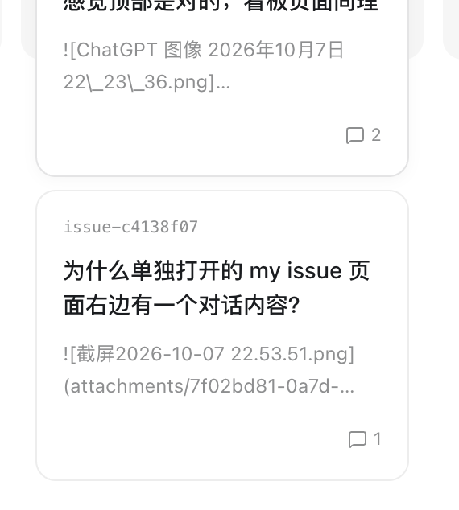

# 看板列固定高度，卡片裁切并在列内上下滚动

- ID：`issue-ccec8842-e096-4a84-9064-ea16534cb548`
- 类型：UI
- 状态：待处理
- 范围 / 关联：来源项目 MyIssue：`my-issue/issues/issue-ccec8842-e096-4a84-9064-ea16534cb548.md`；按用户要求登记于 GitTogether 当前工作副本。
- 版本管理标识：`versioncontrolid`

## 目标与当前事实

当前看板卡片会溢出列背景，超出背景高度后仍显示在背景外。此 Issue 本轮仅登记到 GitTogether 的 `issue/`，尚未开始实现。

预期行为：

- 固定看板列的背景高度，卡片增加时不继续撑高背景。
- 超出列背景范围的卡片应被裁切，始终显示在背景内部。
- 卡片内容超过可用高度时，在列背景内上下滚动查看。

用户原始反馈：

> 卡片会溢出背景，背景高度固定后卡片应该被裁切在背景内上下滚动的

## 实现

- [ ] 固定看板列背景高度，并将超出范围的卡片裁切在列背景内。
- [ ] 卡片内容超出列可用高度时，支持在列内上下滚动。

## 检查

- [ ] 实现后检查列背景高度、卡片裁切和列内滚动行为。

## 用户验收

- [ ] 确认卡片不会溢出列背景，且可在列内滚动查看。

## Comments

### 2026-10-23T17:07:43Z · Codex · unknown

按用户要求将来源于 `my-issue` 项目看板的 Issue 登记到 GitTogether 当前工作副本的 `issue/`，保留原稳定 ID 与截图。此次只登记 Issue，未修改实现代码。
