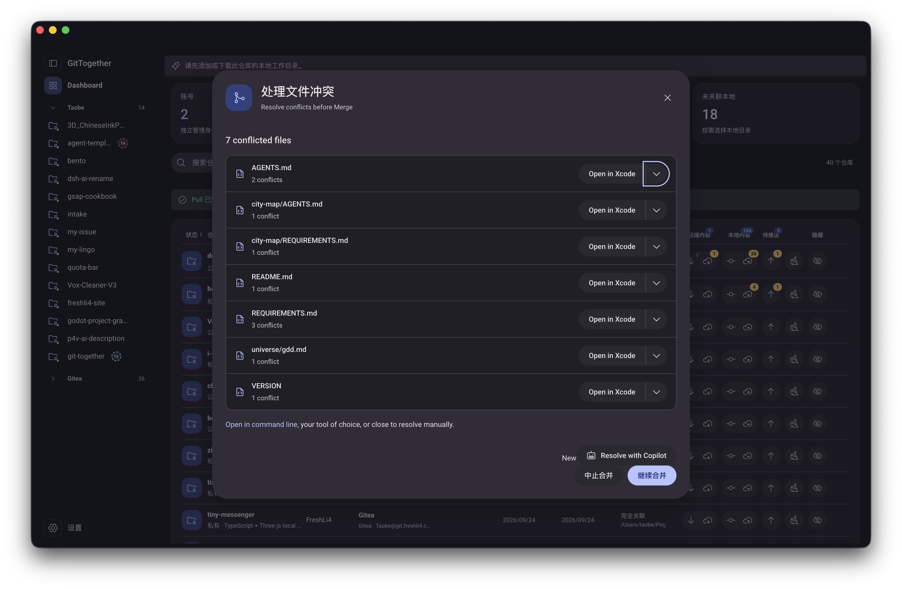

# Description

用户截图中的“Resolve with Copilot”改为“Resolve with AI”，移除不必要的 New 提示。AI 按钮与“中止合并”及“继续合并”处于同一横行，AI 按钮在该行左侧，保留现有 Material 视觉与窄窗口可用性。保留原版 AI 执行回调、权限和可用性判断；本 issue 仅负责显示名称及布局。

验收：有冲突且 AI 可用时显示 Resolve with AI；与中止合并同行，左对齐；不再单独挤到上一行。

用户提供的原始截图：

# Comments

## 20261023-165931_Codex_GPT-6-Luna

原记录标题：2026-10-23T16:59:31.323Z · Codex · gpt-6-luna

实现完成，状态进入 in_review。\n\n**变更**\n- 冲突弹窗按钮及提示文案改为 “Resolve with AI”，移除 “New” 气泡；保留原 Copilot 执行回调、功能开关、账户资格判断及冲突可用性检查。\n- Material 底部将 AI 按钮放在操作组左侧；窄于 480px 时允许安全换行，避免控件挤压。\n- 配套依赖变更保留在同一合并状态：冲突进度/提交保护、merge/rebase 文件文案，以及编辑器选择与系统默认打开行为。来源锁登记了 80 个精确授权补丁，并为改动的控制器类补充/更新摘要。\n\n**文件**\n- 本项：desktop/app/src/ui/multi-commit-operation/dialog/conflicts-dialog.tsx、desktop/app/src/ui/gittogether/presentation.scss\n- 依赖代码：desktop/app/src/lib/editors/win32.ts、desktop/app/src/lib/stores/app-store.ts、desktop/app/src/ui/dispatcher/dispatcher.ts、desktop/app/src/ui/gittogether/conflict-progress.ts、desktop/app/src/ui/lib/button.tsx、desktop/app/src/ui/lib/conflicts/render-functions.tsx、desktop/app/src/ui/lib/conflicts/unmerged-file.tsx、desktop/app/src/ui/multi-commit-operation/base-multi-commit-operation.tsx、desktop/app/src/ui/preferences/integrations.tsx、desktop/app/src/ui/preferences/preferences.tsx\n- 边界与回归：docs/github-desktop-upstream.json、scripts/verify-upstream.mjs、desktop/app/test/unit/ui/conflicts-dialog-progress-test.tsx、desktop/app/test/unit/ui/conflicts-dialog-submission-test.tsx\n\n**本地检查**\n- npm run verify:upstream：通过，3895 个上游文件、80 个授权补丁。\n- npm run check：通过，包含桌面与 macOS TypeScript 检查及 Rust cargo check。\n- 冲突进度、提交保护、控件原有测试：17/17 通过；Prettier（弹窗与来源锁）、SCSS 编译、git diff --check 均通过。测试输出包含一条现有 react-dom act 可等待版本提示，不影响通过结果。\n\n仍需用户在桌面界面验收按钮的实际视觉位置、窄窗口换行，以及 AI 可用状态下的交互；本次未做 GUI、打包、安装或设备验收，也未声称 AI 实际调用通过。

原执行会话深度链接未记录，未补造。

## 20261023-165945_Codex_GPT-6-Luna

原记录标题：2026-10-23T16:59:45.412Z · Codex · gpt-6-luna

排版更正：上一条实施摘要的换行符被写成字面量。下面是正确排版的同一记录。

**变更**
- 冲突弹窗按钮及提示文案改为 “Resolve with AI”，移除 “New” 气泡；保留原 Copilot 执行回调、功能开关、账户资格判断及冲突可用性检查。
- Material 底部将 AI 按钮放在操作组左侧；窄于 480px 时允许安全换行，避免控件挤压。
- 配套依赖变更包括冲突进度/提交保护、merge/rebase 文件文案，以及编辑器选择与系统默认打开行为。来源锁登记了 80 个精确授权补丁，并为改动的控制器类补充/更新摘要。

**文件**
- 本项：desktop/app/src/ui/multi-commit-operation/dialog/conflicts-dialog.tsx、desktop/app/src/ui/gittogether/presentation.scss
- 依赖代码：desktop/app/src/lib/editors/win32.ts、desktop/app/src/lib/stores/app-store.ts、desktop/app/src/ui/dispatcher/dispatcher.ts、desktop/app/src/ui/gittogether/conflict-progress.ts、desktop/app/src/ui/lib/button.tsx、desktop/app/src/ui/lib/conflicts/render-functions.tsx、desktop/app/src/ui/lib/conflicts/unmerged-file.tsx、desktop/app/src/ui/multi-commit-operation/base-multi-commit-operation.tsx、desktop/app/src/ui/preferences/integrations.tsx、desktop/app/src/ui/preferences/preferences.tsx
- 边界与回归：docs/github-desktop-upstream.json、scripts/verify-upstream.mjs、desktop/app/test/unit/ui/conflicts-dialog-progress-test.tsx、desktop/app/test/unit/ui/conflicts-dialog-submission-test.tsx

**本地检查**
- npm run verify:upstream：通过，3895 个上游文件、80 个授权补丁。
- npm run check：通过，包含桌面与 macOS TypeScript 检查及 Rust cargo check。
- 冲突进度、提交保护、控件原有测试：17/17 通过；Prettier（弹窗与来源锁）、SCSS 编译、git diff --check 均通过。测试输出包含一条 react-dom act 可等待版本提示，不影响通过结果。

仍需用户在桌面界面验收按钮的实际视觉位置、窄窗口换行，以及 AI 可用状态下的交互；本次未做 GUI、打包、安装或设备验收，也未声称 AI 实际调用通过。

原执行会话深度链接未记录，未补造。

## 20261024-163109_Codex

按用户最新手写模板迁移属性和正文结构，保留任务语义、来源、原始状态及历史内容；本次未重新执行业务验收。

源属性保留了执行会话入口（各历史 Comment 的具体归属未另行核实）：[原任务执行会话](codex://threads/01a1699b-f8e3-7653-975a-c5e6bd063ab2)。

本次执行环境未提供具体模型标识，未补造 Model-Detail。

[本次文档迁移对话](codex://threads/01a157b3-610c-73b4-ae06-163c0f8490d3)
