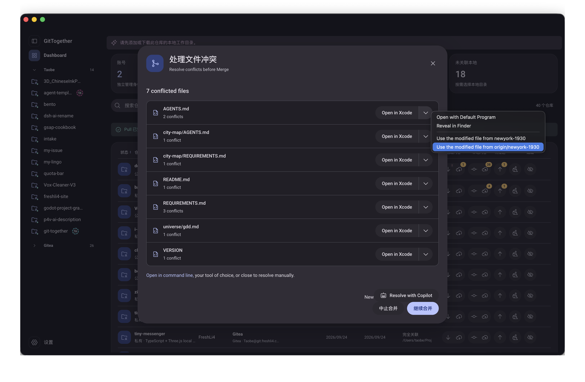

# Description

将截图中的“Use the modified file from …”二选一改为清晰的本地/远端描述。英文按用户要求为“Use local”和“Use remote: <remote-branch-name>”；中文显示“使用本地版本”和“使用远端版本：<远端分支名>”，分支名使用真实来源，如 origin/newyork-1930。同步本地化该冲突菜单的系统默认打开、在文件管理器显示等文案，遵循当前语言设置。仅替换展示，保留原版选择 ours/theirs 的执行方向和非 merge 操作的正确语义。

验收：本地、远端版本可辨认，远端展示实际分支名；中英文正确，不颠倒执行方向。

用户提供的原始截图：

# Comments

## 20261023-163642_Codex_GPT-6-Luna

原记录标题：2026-10-23T16:36:42.074Z · Codex · gpt-6-luna

#### 2026-10-24 — 只读定位与依赖等待

依赖 `issue-00a60f15-8716-418c-85be-2fd23551c0de` 当前仍是 `handoff_ready=false`，本项维持 `todo` / `waiting_for_dependency`，尚未改源码。

已定位冲突菜单在 `desktop/app/src/ui/lib/conflicts/unmerged-file.tsx` 组装，经 `showContextualMenu` 交给原生菜单；两侧选项分别调用原有 `ours` / `theirs` action。当前标签由 `desktop/app/src/lib/status.ts` 生成，本项会保持该文件不变。菜单中的来源分支来自冲突状态 `theirBranch`；原截图实际提供 `origin/newyork-1930`。

只读搜索没有发现应用内语言选择设置。实现时按渲染器当前系统/Chromium locale 选择中英文；这条待依赖交接后随代码确认。

原执行会话深度链接未记录，未补造。

## 20261023-165027_Codex_GPT-6-Luna

原记录标题：2026-10-23T16:50:27.582Z · Codex · gpt-6-luna

#### 2026-10-24 — 菜单文案实现与局部检查

实现并可交接，用户交互/视觉验收仍待处理。

改动文件：
- `desktop/app/src/ui/lib/conflicts/unmerged-file.tsx`：按渲染器语言环境本地化“系统默认打开”和 Finder / 资源管理器 / 文件管理器文案。Merge 的修改文件选项显示 `Use local` / `Use remote: <theirBranch>`，中文显示“使用本地版本” / “使用远端版本：<theirBranch>”，分支直接使用冲突状态的真实来源名（如 `origin/newyork-1930`）。Rebase、Cherry-pick 等按原分支语义显示；Added / Deleted 仍区分保留与排除文件。两个选项仍分别调用原有 `ours` / `theirs`，未改 `lib/status.ts`、Git 或 Dispatcher。
- `desktop/app/src/ui/multi-commit-operation/base-multi-commit-operation.tsx`、`desktop/app/src/ui/multi-commit-operation/dialog/conflicts-dialog.tsx`：仅把 operation kind 传给菜单展示层，用于避免非 Merge 操作被称作远端。
- `desktop/app/test/unit/ui/conflicts-dialog-progress-test.tsx`：为已有夹具补 operation kind 参数；未改测试断言。

实际检查：
1. 在 `desktop/` 执行 Prettier `--check`，覆盖 `unmerged-file.tsx`、`base-multi-commit-operation.tsx` 和现有冲突进度夹具：通过。
2. 在 `desktop/` 执行 TypeScript `tsc --noEmit`：通过。
3. 对上述四个文件执行 `git diff --check`：通过。

未运行测试、GUI、运行时或安装包验收；用户验收待处理。共享 upstream 来源锁/校验未在本项修改，需由布局 Issue 最后统一登记本项的 UI 展示差异（尤其 `unmerged-file.tsx`、`base-multi-commit-operation.tsx` 与 `conflicts-dialog.tsx`）；因此未声称 `verify:upstream` 通过。

原执行会话深度链接未记录，未补造。

## 20261024-163109_Codex

按用户最新手写模板迁移属性和正文结构，保留任务语义、来源、原始状态及历史内容；本次未重新执行业务验收。

源属性保留了执行会话入口（各历史 Comment 的具体归属未另行核实）：[原任务执行会话](codex://threads/01a1699b-f62b-7f13-98d9-937c9552093a)。

本次执行环境未提供具体模型标识，未补造 Model-Detail。

[本次文档迁移对话](codex://threads/01a157b3-610c-73b4-ae06-163c0f8490d3)
